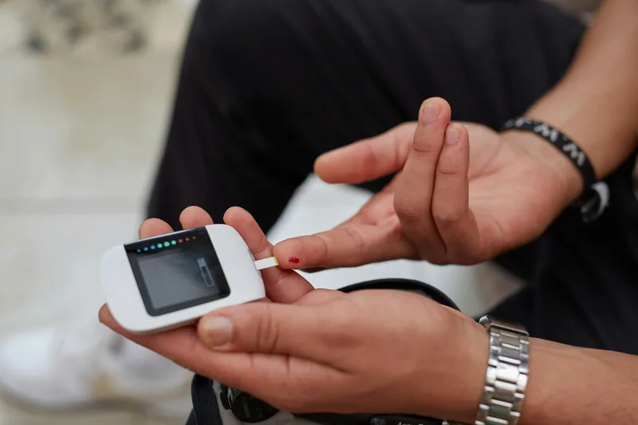

# Northcrest component guide (for page builders): FROZEN class names

Brand: **Northcrest Multispeciality Hospital** (fictional), 21 Outer Ring Road, Hebbal, Bengaluru 560024. Helpline +91 80 4718 2200,
**Emergency 24/7 +91 80 4718 1000**, ambulance **108**, email care@northcrest.example. OPD Mon to Sat 8:00 to 20:00 (Paediatrics daily, Emergency 24/7).
450 beds, 96 ICU beds, 120+ consultants, 12 departments, 14 theatres. Founded 1998. Tone: precise, modern, trustworthy, plain language.
Currency INR (`₹1,200`, en-IN grouping: `Northcrest.fmtPrice(240000)` -> `₹2,40,000`).
Dummy patient: **Priya Raman**, priya.raman@example.com, patient ID **NC-48213**, 35, blood group B+, photo `user-1`. Demo password `Northcrest123`.
Her care: cardiology follow-up with Dr Meera Krishnan (doc-2), thyroid + lipid labs, a past ankle sprain seen by Dr Rahul Menon (doc-5).

Data (single source of truth, also in JS from the generated `data/site-data.js`):
- `data/departments.json` -> `Northcrest.departments` (12: slug, name, short, icon, categories[], tagline, summary, image, consultants, opd, floor,
  detail, page; the 6 detail ones add hero, overview, facts, conditions, procedures, technology, faqs) and `Northcrest.categories`
  (`medical`, `surgical`, `women-children`, `diagnostics-emergency`). Slugs: cardiology neurology orthopaedics oncology paediatrics gynaecology
  gastroenterology pulmonology nephrology ent dermatology emergency.
- `data/doctors.json` -> `Northcrest.doctors` (doc-1..12: name, gender, title, department, qualifications[], chips[], experience, languages[],
  opd[], opdTime, rating, reviews, fee, status available|busy|away, bio, education[[degree, institution, year]], awards[]).
  Helpers: `Northcrest.deptBySlug('cardiology')`, `Northcrest.doctorById('doc-3')`.

## Rules
- Write ONLY `src/pages/<page>.html`, `css/pages/<page>.css`, `js/pages/<page>.js` (blog posts share `blog-post.css/js`; department pages share
  `department.css/js` and `src/templates/department.html`). Never edit `css/site.css`, `js/site.js`, `js/validation.js`, `src/partials/*`,
  `scripts/build.py`, `data/*.json`. Need a shared change? Report it.
- Pages with a STUB comment are yours to replace. After every edit: `python3 scripts/build.py` (from `site/`). Never hand-edit root `*.html`.
- Photos: only those assigned to your page in `images/ASSIGNMENT.md`. Every ``: alt, real width/height, `loading="lazy" decoding="async"` below the fold.
- Logical properties only (`margin-inline`, `inset-inline-start`, `text-align: start`). Arrow icons get `class="flip"`.
- ONE primary CTA style `btn btn-primary` (solid navy, **8px radius, never pills**). Max 2 CTAs in a hero. Two adjacent buttons never go to the same page.
- Section header = `.intro` (eyebrow, h2, one paragraph right under it). h1 <= 40 chars, hero `lead` <= 120 chars (equal inner-hero heights).
- Emergency red (`--emergency`) ONLY for emergency strip/band/badges (`btn-emergency`, `icon-badge--red`, `quick-tile--emergency`).
- Dashboard: every button gives feedback (`data-toast`, modal, drawer or state change).
- QA: `node tests/qa.cjs . --pages yourpage.html --quick`. Fix everything it reports for your page.

## Visual identity (Northcrest is NOT Tidewell/Drivora; do not bring back pills, pebbles, waves, blobs or ring photos)
- Fonts: headings **Urbanist** 700/800 (tight letter-spacing), body **Public Sans**. Tokens `--f-head`, `--f-body`.
- Palette: indigo-navy `--primary #1E2A78` (hover `#16205E`), medical blue `--accent #2F6FED`, link/eyebrow text `--primary-ink #2149C6`,
  white `--bg`, cool grey panel `--tint #F4F6FB`, light blue panel `--sand #EEF3FE` (`section--blue`), ink `--ink #111A3E`, `--muted`.
  Dark theme: midnight navy `#0B1230` with bright blue `#5B8CFF` (automatic through tokens).
- Shapes: crisp. Controls/buttons/inputs/chips `--ctl-r` **8px**, cards/panels `--r-md` **12px**, big frames `--r-xl` 16px, icon badges 10px. 1px borders.
- Sections: `section` (white), `section--tint` (grey), `section--blue`, `section--line` (top hairline), `band` (navy, for stats/emergency info; max 2 per page).
  `section--tight` = less padding. Dense, information-rich layouts; 4-column grids where there is content for it.
- Motion: automatic (fade-up on scroll, count-up numbers, hero dock rise); off for reduced motion and automation. Never add `data-reveal` yourself.

---

## Build system (`scripts/build.py`)
Front matter keys: `layout` (public | app | auth), `title`, `description`, `nav` (home1 home2 about departments doctors blog contact dashboard),
`app_nav` (overview appointments reports prescriptions billing profile) + `app_title`, `hero` (slot -> standard inner hero) with `hero_alt`, `crumbs`
(`Doctors` or `Departments=departments.html|Heart care`), `eyebrow`, `h1`, `lead`; `preload` (home pages), `css`, `js`, `body_class`,
`template` + `department` (detail pages). Missing photos never break the build (icon panel / plain navy hero fallback + note in the output).

| Macro | Output |
|---|---|
| `{{dept_tiles all}}` | 12 department tiles with `dept-*` photos, `id="dept-<slug>"`, `data-group="<categories>"` (Departments page ONLY). Put in `<div class="cards cards--4" id="deptGrid">` |
| `{{dept_tiles a,b,c major}}` | chosen tiles with `major-<slug>` photos (Home 1). `... none` = icon panel, no photo (any page) |
| `{{dept_chips #deptGrid}}` | category filter chips (All + 4 categories), wired by site.js |
| `{{dept_links detail}}` / `{{dept_links a,b}}` | compact text tiles (icon badge + name + short + arrow), no photos; add `except-current` on detail pages |
| `{{dept_options}}` | `<option value="slug">Name</option>` x12 for selects |
| `{{doctor_cards all}}` / `{{doctor_cards cardiology}}` / `{{doctor_cards doc-1,doc-5}}` | profile cards (doctors page ONLY: photos) |
| `{{doctor_list cardiology}}` | text rows linking to `doctors.html#doc-N` (name, title, chips, OPD). No photos, any page |
| `{{icon name 18}}` | inline SVG icon. Names: heart brain bone ribbon child female stomach lungs kidney ear skin ambulance clock people check shield search calendar phone stethoscope pill file bed flask scan building star map mail lang card tooth |
| `{{badge name}}` / `{{badge name red lg}}` | `.icon-badge` with icon; modifiers `sm lg red navy` |
| `{{icon_arrow}}` | the flip arrow used in `.link` |
| department template (`{{d.name}} {{d.slug}} {{d.short}} {{d.summary}} {{d.overview}}`) | `{{d_facts}} {{d_conditions}} {{d_procedures}} {{d_technology}} {{d_faq}} {{doctor_list}}` |

Doctor/department card link rules: detail departments link to `department-<slug>.html`, the other 6 to `contact.html?dept=<slug>#appointment`.
Doctor "Book appointment" -> `dashboard-appointments.html?doctor=doc-N`; "View profile" is `button[data-doctor-profile="doc-N"]`
(**doctors page JS opens the profile modal** with bio, education, awards from `Northcrest.doctorById`). Other pages must not show doctor photos.

## Page shell (partials, do not copy)
1. **Utility strip** `.utility-strip` (navy, NOT sticky): red "Emergency 24/7" chip, Ambulance 108, Health helpline, OPD hours, languages.
2. **Sticky white navbar** `#siteHeader`: logo left, nav centred (Home v [Home 1, Home 2] · About · Departments · Doctors · Blog · Contact · Dashboard),
   actions right: theme, RTL ("RTL"/"LTR"), **Log in**, CTA **Book appointment** (`data-nav-cta` -> `contact.html#appointment`; Contact MUST keep
   `id="appointment"`; Home 2 MUST keep `id="packages"` (health check-ups, linked from Home 1); Contact should have `id="emergency"` and `id="map"`). Menu button below 1200px; under 640px Log in moves into the menu.
3. Footer `.site-footer` (light grey): health-tips signup row (`.footer-news` + `.news-form`), 4 columns (brand + contact icons | Quick links = nav |
   Departments | Patient services incl. Privacy/Terms), navy bottom bar `.footer-bar` (copyright + socials).
4. App shell: **dark navy sidebar** (white icons; Overview, Appointments, Medical reports, Prescriptions, Billing, Profile; red emergency box;
   Back to website, Log out; off-canvas below 1024px) + white app header (menu, title, theme, RTL, avatar menu). Body goes in `<main class="app-content">`
   on a light grey background (grid, gap 20px).

---

## Heroes
Home (hand-written; Home 1 = search dock version, Home 2 must use a different layout below the hero):
```html
<section class="hero hero-home1" aria-labelledby="hero-title">
  
  <div class="hero-shade" aria-hidden="true"></div>                       <!-- crisp navy-to-transparent overlay; text is WHITE -->
  <div class="container hero-content"><p class="eyebrow eyebrow-pill">…</p><h1 id="hero-title">…</h1><p class="hero-lead">…</p>
    <div class="hero-ctas"><a class="btn btn-primary btn-lg" …>…</a><a class="btn btn-secondary btn-lg" …>…</a></div></div>
</section>
<div class="hero-dock"><div class="container">                              <!-- overlaps the hero bottom edge -->
  <form class="search-panel" action="doctors.html" role="search" data-validate novalidate data-search-form data-no-reset> … .search-row (input name=q, select name=dept, submit) … </form>
  <nav class="quick-bar" aria-label="Quick actions"><a class="quick-tile" href="…">{{badge calendar}}<strong>…</strong><span>…</span></a> ×4 </nav>
</div></div>
```
`data-search-form`: on valid submit site.js goes to `action?q=…&dept=…` (empty fields dropped). **doctors.html must read `?q=` and `?dept=`.**
Inner hero: front matter `hero:` etc. (same height everywhere; navy overlay, white text, breadcrumbs). Photo-less pages: `.title-band` (grey).

## Cards (subgrid: rows level across a row; a card has EXACTLY --rows direct children)
Grids: `cards cards--4` (4 cols >=1200, 2 cols 640-1199, 1 col <640), `cards--3` (3 >=1024, 2 at 640-1023), `cards--2`, `cards--trio` (exactly 3).
Rows: `card--rows-3 … card--rows-8` (default 6). Card = white, 1px border, 12px radius; media is edge-to-edge at the top.
- Department tile (5 rows, macro): `.dept-tile` > `.card-media.dept-media` (photo + floating `.icon-badge`) / `h3.card-title` / `p.card-text` / `ul.meta` / `a.link`.
- Doctor card (6 rows, macro): `.doctor-card` > `.card-media.card-media--portrait.doc-media` (photo + `.avail.avail--ok|warn|muted` status dot) /
  `h3.card-title` / `ul.degree-chips > li` / `p.card-sub` (department link · years) / `ul.meta` (languages, OPD days, rating) / `.card-actions` (View profile + Book appointment).
- Facility card (4 rows): `card card--rows-4 facility-card` > `.card-media img` / `h3.card-title` / `p.card-text` / `ul.meta`.
- Info card (3 rows): `card card--rows-3 info-card` > `{{badge stethoscope}}` / `h3.card-title` / `p.card-text`. (4 rows: add `a.link` or `ul.meta`.)
- Package / price card (Home 2 check-ups, 6 rows suggested): `card card--rows-6` > `{{badge flask}}` / `.card-kicker` (badge + duration) / `h3.card-title` /
  `p.card-text` / `p.price` (`<span class="price-from">From</span> ₹2,499 <span class="price-note">per person</span>`) / `a.btn.btn-primary`.
- Blog card (6 rows; QA needs these classes):
```html
<article class="card blog-card" id="post-2" data-group="diabetes">
  <div class="card-media"></div>
  <div class="card-kicker"><span class="badge">Diabetes</span><time datetime="2026-10-12">12 Oct 2026</time></div>
  <h3 class="card-title"><a href="blog-post-2.html">…</a></h3>
  <p class="card-text">…</p>
  <div class="author"><span class="author-text"><span class="author-name">Name</span><span class="author-role">…</span></span></div>
  <a class="link" href="blog-post-2.html">Read article {{icon_arrow}}</a>
</article>
```
Featured post + 6 cards in `cards cards--3`, filter chips, no pagination.

## Filter chips (departments, doctors, blog): built into site.js
```html
<div class="chips" role="group" aria-label="Filter …" data-filter-group="#grid">
  <button class="chip" type="button" data-filter="all" aria-pressed="true">All</button><button class="chip" type="button" data-filter="key" aria-pressed="false">…</button></div>
<p class="result-count" data-filter-count data-template="Showing {n} doctors" aria-live="polite">Showing 12 doctors</p>
```
Items carry `data-group` (space-separated allowed). Event `filter:change` on the grid. Doctor search: filter `.doctor-card[data-search]` in page JS. Not sticky.

## Navy stats band (count-up automatic)
```html
<section class="section band"><div class="container"><header class="intro intro--center">…</header>
  <div class="stat-band"><div><strong>450</strong><span>beds</span></div> ×4 </div></div></section>
```
`.stat-band` also works on white (bordered cells). Numbers in `strong` count up (keeps ₹ % + suffixes).

## Testimonials (3 cards; star row; small square photo top-left; quote)
```html
<div class="testimonials"><figure class="testimonial">
  <figcaption class="t-head"><span class="t-person"><span class="t-name">Name</span><span class="t-role">Treatment, Department</span></span></figcaption>
  <div class="t-rating" role="img" aria-label="Rated 5 out of 5">{{icon star}}×5</div>
  <blockquote><p>Quote without typographic quote marks.</p></blockquote>
</figure> ×3 </div>
```

## Tabs + timing tables (use for visiting hours / OPD timings / insurance etc.)
```html
<div data-tabs>
  <div class="tabs tabs--center" role="tablist" aria-label="Hospital timings">
    <button class="tab" role="tab" id="t-visit" aria-controls="p-visit" aria-selected="true">Visiting hours</button> …</div>
  <div class="tab-panel" role="tabpanel" id="p-visit" aria-labelledby="t-visit">
    <div class="table-wrap"><table class="timing-table"><thead><tr><th scope="col">Area</th><th scope="col">Hours</th></tr></thead>
      <tbody><tr><th scope="row">General wards</th><td>16:00 to 19:00</td></tr><tr><th scope="row">Emergency</th><td class="open-24">Open 24/7</td></tr></tbody></table></div>
  </div></div>
```
Segmented tab bar (grey track, active tab solid navy). Generic data table: `.table-wrap > table.table` (`table--compact` in the dashboard).

## FAQ (boxed accordion, chevrons, centred 760px column)
```html
<div class="faq"><div class="faq-group"><h3>Appointments</h3><div class="faq-list">
  <details class="faq-item" name="faq-a"><summary>Question?</summary><div class="faq-answer"><p>…</p></div></details></div></div></div>
```

## Other blocks
- Split: `.split` (`split--reverse`) > `.split-media img` + `.split-body` (eyebrow, h2, p, `ul.checklist`).
- Centred vertical timeline: `<ol class="timeline"><li><span class="tl-year">1998</span><h3>…</h3><p>…</p></li></ol>`.
- Emergency band: `.emergency-band` > `{{badge ambulance red lg}}` + div (eyebrow, h2, p) + `.em-actions` (`a.em-number` + `a.btn.btn-emergency`).
- CTA band: `.cta-band` (navy gradient, white text; `.hero-ctas` inside), `cta-band--soft` (light blue).
- Department text tiles `.dept-links`; doctor text rows `.doc-list > .doc-row`; conditions `.condition-grid`.
- Badges `badge` (`--ok --warn --neutral --solid`), status `status status--ok`, steps `.steps > .step` (3 children), `.how-steps`, `ul.checklist`,
  `ul.icon-list`, `ul.meta`, `.panel` (`panel--accent` blue top line, `panel--blue`), `.spec-grid`, `.intro-row`, `.section-actions`, `.note`.

## Forms (auto-validated by `js/validation.js`)
`<form class="form" data-validate novalidate data-success-message="…">` in `.form-card`; `.form-grid > .field` (label + input with placeholder, `field--full`).
Rules: `name` (>=2 letters, no digits), `email` (format, lower-cased on blur), `phone`/`type=tel` (7-15 digits, letters rejected), `type=date` (not past),
`data-rule="password"`, `data-match="#pw"`, `required`. Success `<p class="form-success" data-form-success role="status" hidden>…<span data-success-text>…</span></p>`;
event `form:success`; `data-no-reset`. Card payments: page JS (Luhn/expiry/CVV) on `form:success`. Contact appointment form reads `?dept=` to preselect.

## Modal, drawer, toast, tabs, chart (js/site.js, `window.Northcrest`)
Modal `[data-modal-open="id"]` + `.modal#id[hidden] > .modal-backdrop[data-modal-close] + .modal-dialog[role=dialog][aria-labelledby]` (`modal-dialog--wide`);
`Northcrest.openModal(id)` / `closeModal(id)`. Drawer: `.drawer-scrim` + `aside.drawer` (page JS toggles hidden). Toast: `data-toast="Saved"`
(`data-toast-type="ok|info|error"`) or `Northcrest.toast(msg, type)`. Session: `Northcrest.session.login/logout/user`, `[data-logout]`.
Line chart: `<div data-line-chart='{"label":"Systolic BP","unit":"mmHg","labels":["Jun","Jul","Aug","Sep","Oct","Nov"],"values":[132,128,126,124,121,119],"target":120,"targetLabel":"Target"}'></div>`
or `Northcrest.lineChart(el, {…})`.

## Dashboard (layout: app)
`.page-head` (h1 + p + `.page-head-actions`), `.stat-grid > .stat-card` (`stat-label`, `stat-value`, `stat-hint`), `.dash-grid.dash-grid--2`, `.widget`
(`widget--blue`), `.panel-head`, `.row-list > .row-item`, compact tables `table.table.table--compact`, status pills
`<span class="pill pill--ok">Paid</span>` (`--ok --warn --bad --info`, default grey), `.ring`, line chart, `.empty`, `.toolbar`, `.tabs`.
Booking UI: `.stepper`, `.option-grid > label.option-card`, `.date-strip > button.date-chip[aria-pressed]`, `.slot-grid > button.slot[aria-pressed]`, `.summary`.

## Auth (layout: auth; login/signup/forgot/reset already exist, content may be refined)
`.auth > section.auth-panel (logo, h1, ul.auth-points, .auth-media img) + section.auth-form-wrap > .auth-form`; Google + Apple centred under the heading
(`.social-login`). `.auth-media` identical box on login and sign-up. Forgot/reset: `.auth.auth--single` + `.auth-card`.

## Misc
`.sr-only`, `.ltr-num` (numbers in RTL), `.prose` (articles), `.article-meta`, `.legal-*`, `.avatar`, `.avatar--lg`. Icons: 24px viewBox, 1.8px stroke.
RTL: text blocks use `unicode-bidi: plaintext` already.
